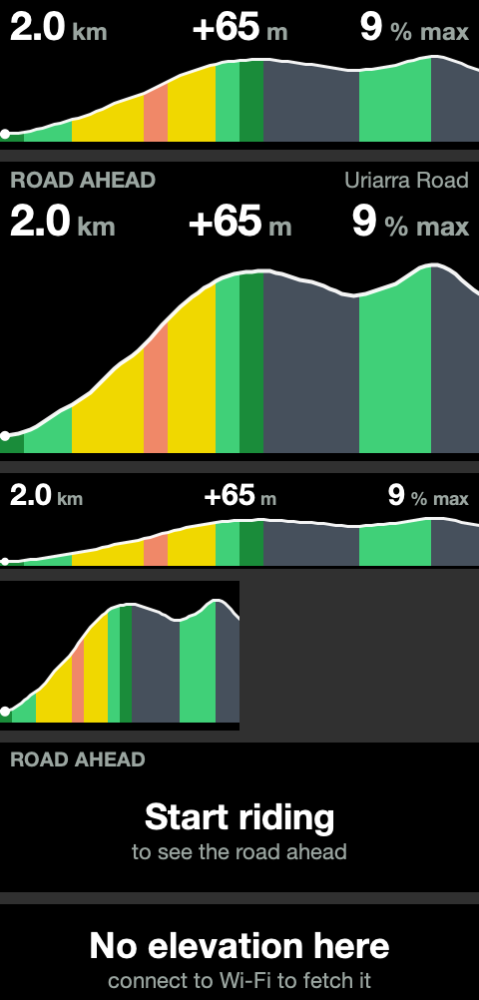

# Road Ahead

A Hammerhead Karoo extension with one ride field, **Road ahead**: the elevation profile of the
road in front of you, with no route loaded. It guesses the road ahead from the one you're on, as
Wahoo's route-less Summit view does. It runs entirely on the Karoo: no phone, no server, no
account.



This is version 0.2.1, a beta. It has been tested on a Karoo 3 at the desk and against recorded
rides. It has not been tested on a Karoo 2. If it gets a road wrong, open an issue and say where.

The page for riders, with pictures and a straight install button: https://karoo-roadahead.pages.dev

Road Ahead is free. If it's useful to you, you can [leave a tip](https://ko-fi.com/glen840924).

## What the field shows

- The profile of the road ahead, coloured by grade in blocks, with you at the left edge. The
  colours match the Karoo's own climb colours. Downhill is grey.
- The distance shown, the climbing inside it and the steepest pitch.
- The name of the road it is following.
- At a T-junction or a fork it carries on along the likeliest road, so the field always shows the
  distance you asked for. Past the first guess the profile is dimmer, with a tick on the line
  where the guessing starts. Turn off the road shown and it redraws within a couple of seconds.
- On a half-width tile it is the graph alone. A flat road runs through the middle of the tile, a
  climb starts low and a descent starts high.

Tap the field to step between 2, 5 and 10 km. It works with or without a route, and before you
press start.

## Install

**On a Karoo 3:**

1. On your phone, open the [latest release](https://github.com/gsq480/karoo-roadahead/releases/latest).
2. Press and hold `roadahead.apk`, choose **Share**, then the Hammerhead app.
3. On the Karoo, tap **Install**.

**On a Karoo 2:** download `roadahead.apk` and run `adb install roadahead.apk` over a cable.

To update, press and hold the app's icon on the Karoo and tap **Update**.

## Set it up

1. Open **Road Ahead** and tap **Allow map access**, then **Allow**. The app closes when you
   allow it, so open it again.
2. Leave the Karoo on Wi-Fi for a minute or two. It fetches the elevation file for where it is,
   and for anywhere within 30 km. One file is about 12 MB. The Karoo turns Wi-Fi off on a ride,
   so do this at home, or where you're staying when you travel.
3. Add the field to a ride page: **Profiles**, your profile, **Data Pages**, a page, **Add
   Field**, **ROAD AHEAD**, **Road ahead**.

The field says **Start riding** until you have moved about 8 m. With no elevation file for where
you are, it says so and draws nothing.

## Settings

The app's screen shows the field as it looks right now, what it has found, and every setting:

- The distances a tap steps through: any of 1, 2, 5, 10 and 20 km.
- Words and numbers on the field: always, only on full-width tiles, or never.
- Text size: large or small. Large leaves the road name off a tile of ordinary height, to keep the graph tall.
- At a junction: carry on along the likeliest road, or stop the picture there.
- The colours: the Karoo's or Wahoo's.
- The numbers on the field: climbing ahead, steepest pitch, or neither.
- How far around you to fetch elevation: 10, 30 or 60 km.
- The elevation files held, each with **Delete**, and **Fetch now**.

Units follow the Karoo's rider profile.

## What it doesn't do well

- It predicts one road. Past a junction it is a guess: the road with the same name, otherwise
  the smallest turn. Turn the other way and the picture jumps. Load a route when you need to be
  sure.
- Set to stop at junctions, in suburbs the profile is often shorter than the distance you asked
  for.
- The elevation grid is 30 m. Off-road, under heavy tree cover and in cuttings, expect the
  shape to be right and the pitch numbers to be soft.
- It doesn't detect climbs or send alerts. The Karoo's Climber does both with no route.

Against nine recorded rides (454 km), the predicted heights sat a median 1.5 to 3.0 m from the
altitude the ride recorded. Carrying on through junctions, the field showed the full 2 km 82% of
the time on average, against 44% when it stops at them. The full 2 km was shown and was the road
then ridden 29% of the time, against 24%. The price is that less of what is shown turns out
right: 58% of the picture on average, against 74%.

## How it works

1. **Find the road** (`core/.../RoadSnap.kt`). Each GPS fix snaps to the nearest mapped road or
   path that runs the way you're heading. A footpath or driveway loses to a road beside it.
2. **Follow the road** (`core/.../RoadFollow.kt`). At the end of a mapped piece it carries on
   along the piece with the same name, otherwise the one that runs straightest (within 30
   degrees), otherwise round a bend where nothing else meets the road. Anything else is a
   junction. There it guesses (the same name, otherwise the smallest turn) and notes where, or
   stops if the rider set it to. A roundabout takes the exit with your road's name,
   otherwise the one that best carries on the way you came in.
3. **Read the heights** (`core/.../Heights.kt`, `Profile.kt`). It samples a 30 m elevation grid
   every 25 m along that road, smooths it, and draws a straight line across bridges and tunnels.
4. **Keep it going** (`core/.../Tracker.kt`). The prediction holds while you stay on it, and a new
   one is worked out when you leave it. Nothing is worked out while you're stopped.

Every number those rules turn on is in `core/.../Rules.kt`.

The roads come from the Karoo's own offline maps, which are Mapsforge files in
`/sdcard/offline/maps`. Only the storage permission opens that folder, so the app targets
Android API 28, where the ordinary prompt can still grant it. Nothing is written there. If the
prompt doesn't appear, grant it over a cable:

```
adb shell pm grant au.com.fjellconsulting.roadahead android.permission.WRITE_EXTERNAL_STORAGE
adb shell pm grant au.com.fjellconsulting.roadahead android.permission.READ_EXTERNAL_STORAGE
```

The elevation comes from Terrain Tiles on AWS Open Data, one file for each degree square.

## Build it yourself

### Layout

- `core/` is the engine. Plain Kotlin, no Android, so it runs and tests on a computer. It also
  holds the reader for the Karoo's map files (`MapRoads.kt`) and the drawing (`Picture.kt`), which
  decides every shape and colour so the Karoo and the computer draw the same picture.
- `app/` is the Karoo extension: the field, the Wi-Fi elevation fetch and the settings screen.
- `replay/` runs a recorded ride through the engine on a computer and scores it.
- `fixtures/` and `out/` are not in git: test data and the replay tool's output.

### Build and test

You need JDK 17 and the Android SDK.

```
./gradlew :core:test
./gradlew :replay:installDist
./gradlew :app:assembleDebug
adb install -r app/build/outputs/apk/debug/app-debug.apk
```

A debug build won't install over the published app, because the published app is signed with a
different key. Uninstall that first.

### Check it at the desk

```
adb shell am start -n au.com.fjellconsulting.roadahead/.SettingsActivity --activity-clear-top --ez demo true --ef lat -35.3272 --ef lng 149.0192 --ef course 330
adb shell am start -n au.com.fjellconsulting.roadahead/.SettingsActivity --activity-clear-top --ez fetch true
adb logcat -s RoadAhead
```

The first command puts the Karoo at the foot of Mount Stromlo Road in Canberra for a minute,
heading up. Use a point and a heading on a road in a map your Karoo holds. The second fetches
elevation files now. The third shows the maps opened, the files fetched and each new prediction.

### Check a map file

```
./replay/build/install/replay/bin/replay map fixtures/some.map -35.3272 149.0192 330
```

It prints the file's version and zoom levels, which tags its roads carry, whether pieces stop at
the map tile's edge, how many roundabouts it finds, and where the engine goes from that point. A
`.map` file also works as the road file of a replay, in place of the text extract.

### Replay a ride

```
./replay/build/install/replay/bin/replay fixtures/roads.tsv fixtures fixtures/ride.csv
```

Arguments: the road file, the folder that holds the `.hgt` elevation files, and the ride. Options:

- `--want 5000` asks for 5 km ahead in place of 2 km.
- `--cut` chops the roads into map tiles first, the way the Karoo's map files hand them over.
  The scores must not change.
- `--stop` replays the rule that stops at junctions, to compare.
- `--trace` lists every new prediction and every miss.
- `--png 58` draws what the field shows at fix 58, at four field sizes, to `out/field-58.png`.
- `--dump 319` writes the predicted road and the ride after fix 319 to `out/dump-319.txt`.
- `--moments out/m.json` writes a sample of what the field would have shown.

It reports how often the picture was the road then ridden, who turned when it wasn't, and how far
the predicted heights sat from the ride's own altitude.

### Test data

All of it lives in `fixtures/`, which git ignores.

- **Elevation:** a `.hgt` file from Terrain Tiles on AWS Open Data, named by its south-west
  corner. For example, `curl -O https://elevation-tiles-prod.s3.amazonaws.com/skadi/S36/S36E149.hgt.gz`,
  then `gunzip`.
- **Roads:** a text file made from an Overpass API query for every `highway` way in a box
  (`out tags geom`). One road a line, tab-separated: kind, name, ref, flags (`o` one-way, `r`
  roundabout, `b` bridge, `t` tunnel), then the points as `lat,lng` pairs with spaces between.
  Overpass answers 406 without a `User-Agent` header.
- **A map in the Karoo's format:** any file from `download.mapsforge.org/maps/v5/`.
- **Rides:** a CSV with no header: `time_s,lat,lng,altitude_m`.

## Credits and licence

Road Ahead is released under the Apache License 2.0. See `LICENSE`.

Road data is from OpenStreetMap contributors (ODbL). Elevation data is from Terrain Tiles on AWS
Open Data. Map files are read with Mapsforge (LGPL-3.0), unmodified. The Karoo SDK is
Hammerhead's `karoo-ext` (Apache-2.0). Grade colours follow the Karoo's own climb colours.

Road Ahead is not made or endorsed by Hammerhead, SRAM or Wahoo.
